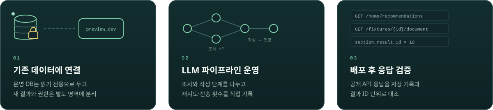

<h1 align="center">이우진</h1>

  <picture>
    <source media="(prefers-color-scheme: dark)" srcset="https://readme-typing-svg.demolab.com/?font=Manrope&amp;weight=600&amp;size=23&amp;duration=1900&amp;pause=800&amp;color=9CDDBF&amp;center=true&amp;vCenter=true&amp;width=428&amp;height=42&amp;repeat=false&amp;lines=Backend+Engineer+%C2%B7+Applied+AI">
    
  </picture>

<strong>운영 데이터에 AI 기능을 연결하는 백엔드 개발자입니다.</strong>

  
  
  

## 소개

메트릭스튜디오에서 AWS Lambda, DynamoDB, OpenSearch, SQS를 사용하는 서버리스 백엔드에서 일했습니다. 지금은 기존 서비스의 데이터에 LLM 기능을 붙이고, 배포한 뒤 사용자가 받는 응답까지 확인하는 일을 하고 있습니다.

설계를 시작할 때는 **어떤 데이터를 읽고 어디에 쓸지**, **어떤 결과를 보고 완료로 판단할지**부터 정합니다. 배포 후에는 사용자가 받는 응답을 저장 기록과 대조합니다.

## 기술 스택

<table>
  <tr>
    <td width="150"><b>Backend</b></td>
    <td></td>
  </tr>
  <tr>
    <td><b>Data</b></td>
    <td></td>
  </tr>
  <tr>
    <td><b>AI · LLM</b></td>
    <td>
      
      
      
      
    </td>
  </tr>
  <tr>
    <td><b>Cloud · Deploy</b></td>
    <td></td>
  </tr>
  <tr>
    <td><b>Frontend</b></td>
    <td></td>
  </tr>
</table>

## 대표 프로젝트

**BenchMark**는 경기 기록과 외부 근거를 모아 축구 팬에게 경기 전 프리뷰를 제공하는 개인 프로젝트입니다. 요구사항과 데이터 쓰기 경계를 정하고, 코딩 에이전트의 구현·검토 결과를 검증했습니다.

  
  
  
  

- **데이터 경계** · 운영 경기 데이터는 읽기 전용으로 쓰고, 생성 결과와 실행 기록은 `preview_dev`에 따로 저장합니다.
- **조사와 작성 분리** · Google Search 도구는 조사 단계에만 붙이고, 작성 단계는 저장된 근거 묶음만 읽습니다. 작성에 쓴 자료를 실행 기록에서 다시 확인할 수 있습니다.
- **공개 기준** · 홈은 요청마다 모델을 부르지 않고 저장된 문서를 읽습니다. 새 생성이 실패해도 이전 정상 문서를 유지하고, 선수 정본과 맞지 않는 본문은 공개하지 않습니다.

### 기능별 구현

| 기능 | 구현에서 답한 질문 |
|---|---|
| [홈 추천·저장 프리뷰](https://github.com/lebind12/benchmarkV3/tree/main/docs/portfolio/home) | 새 생성이 실패해도 공개 문서를 유지하는가? |
| [프리뷰 생성 엔진](https://github.com/lebind12/benchmarkV3/tree/main/docs/portfolio/preview-generation) | 조사 결과가 다섯 섹션으로 어떻게 바뀌는가? |
| [Vertex AI 호출 제어](https://github.com/lebind12/benchmarkV3/tree/main/docs/portfolio/vertex-ai) | 재시도와 실제 전송 횟수를 어디서 관리하는가? |
| [수집·실행 관리](https://github.com/lebind12/benchmarkV3/tree/main/docs/portfolio/collection) | 수집 API가 생성 엔진을 어떻게 호출하는가? |
| [선수 정본·이름 번역](https://github.com/lebind12/benchmarkV3/tree/main/docs/portfolio/player-storage) | AI 결과를 DB 선수·한국어 이름과 어떻게 연결하는가? |
| [인증·개발 세션](https://github.com/lebind12/benchmarkV3/tree/main/docs/portfolio/auth) | 기존 계정을 바꾸지 않고 관리자 테스트를 하는가? |
| [배포와 실행 경계](https://github.com/lebind12/benchmarkV3/tree/main/docs/portfolio/deployment) | 프론트와 API는 어디서 실행하고 무엇을 배포해야 하는가? |

### 배포하며 고친 것

- 배포 묶음에서 `docs/`를 뺐더니 추천 API가 500을 반환했습니다. 앱이 `docs/spec/schemas`의 JSON을 런타임에 읽고 있었습니다. 스키마를 포함해 재배포한 뒤, 프로세스 health 대신 추천·문서 API 응답과 결과 ID 10개를 저장 기록과 대조했습니다.
- 수집 역할에 선수 정본 테이블의 INSERT 권한이 없어 모델 응답은 200인데 저장이 실패했습니다. 세 테이블 권한을 보완한 뒤 정본 저장과 공개 조회를 다시 확인했습니다.

<b>아키텍처 도식 보기</b>

 

## 다른 작업

| 프로젝트 | 내용 | 스택 |
|---|---|---|
| [JPA_Visualize](https://github.com/lebind12/JPA_Visualize) | N+1 · OSIV · dirty checking 함정의 쿼리 수와 실행 시간 시각화 | Spring Data JPA · React · Testcontainers |
| [code-playground](https://github.com/lebind12/code-playground) | 코딩 테스트 게임 플랫폼 *(진행 중)* | Django Channels · FastAPI · RabbitMQ |
| [flow-file-extension-blocker](https://github.com/lebind12/flow-file-extension-blocker) | 파일 확장자 차단 관리, 동시성 테스트 포함 | Spring Boot · Vue |
| [EveryDay_Algorithm](https://github.com/lebind12/EveryDay_Algorithm) | 알고리즘 풀이 기록 | Java |

## GitHub 활동

  <a href="https://github.com/lebind12?tab=overview">
    <picture>
      <source media="(prefers-color-scheme: dark)" srcset="https://github-readme-stats.vercel.app/api?username=lebind12&amp;hide_title=true&amp;hide_rank=true&amp;hide=stars%2Cissues%2Ccontribs&amp;show_icons=true&amp;disable_animations=true&amp;border_radius=14&amp;bg_color=10262A&amp;title_color=F4FBF6&amp;text_color=E3F1EA&amp;icon_color=81D3AD&amp;border_color=284448">
      
    </picture>
  </a>
  <picture>
    <source media="(prefers-color-scheme: dark)" srcset="https://streak-stats.demolab.com/?user=lebind12&amp;background=10262A&amp;border=284448&amp;stroke=284448&amp;ring=81D3AD&amp;fire=E8C872&amp;currStreakNum=F4FBF6&amp;sideNums=F4FBF6&amp;currStreakLabel=9CDDBF&amp;sideLabels=9DB8AE&amp;dates=6F8C84&amp;border_radius=14&amp;hide_border=false">
    
  </picture>

  <picture>
    <source media="(prefers-color-scheme: dark)" srcset="https://github-readme-activity-graph.vercel.app/graph?username=lebind12&amp;bg_color=10262A&amp;color=9DB8AE&amp;title_color=F4FBF6&amp;line=81D3AD&amp;point=E8C872&amp;area=true&amp;area_color=81D3AD&amp;hide_border=true&amp;radius=14">
    
  </picture>

  <picture>
    <source media="(prefers-color-scheme: dark)" srcset="https://raw.githubusercontent.com/lebind12/lebind12/output/github-snake-dark.svg">
    
  </picture>

## 경력·교육

| 기간 | |
|---|---|
| 2025.01 – 2025.12 | 삼성 청년 SW·AI 아카데미 (SSAFY) 13기 |
| 2023.03 – 2023.08 | K-Digital AI 데브코스 |
| 2021.09 – 2022.08 | **메트릭스튜디오** 백엔드 · AWS 서버리스 |
| | 42 Seoul · 숭실대학교 컴퓨터학부 |

