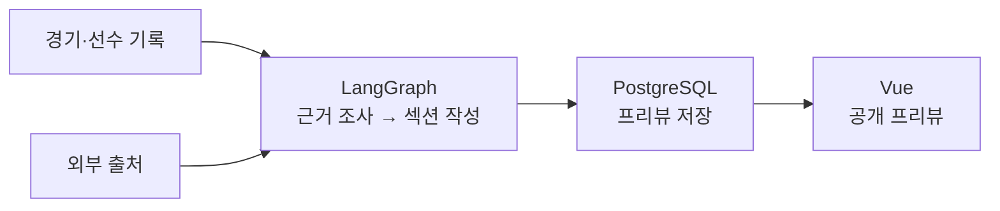

# 이우진

운영 데이터를 연결한 LLM 파이프라인을 설계하고, 배포 후 실제 서비스 응답을 검증하는 백엔드 개발자입니다.

· [이메일](mailto:lebind12@naver.com)

## BenchMark · AI 축구 경기 프리뷰

경기 기록과 외부 근거를 모아, 축구 팬이 경기 전에 주목 선수와 팀 전망을 한 화면에서 읽을 수 있게 했습니다. 관리자는 프리뷰에 쓰인 근거와 실행 이력을 확인할 수 있습니다. [프로젝트 저장소](https://github.com/lebind12/benchmarkV3)

### 설계에서 중요했던 결정

- **운영 데이터 쓰기 경계** · 프리뷰 생성은 운영 경기·선수 데이터를 읽고, 생성 결과와 실행 기록을 `preview_dev`에 저장합니다. [데이터와 저장 경계](https://github.com/lebind12/benchmarkV3/blob/main/docs/portfolio/deployment/README.md)
- **근거 조사와 작성 분리** · LangGraph의 조사 단계에서 외부 출처를 수집하고, 작성 단계는 준비된 근거를 사용합니다. [생성 엔진](https://github.com/lebind12/benchmarkV3/blob/main/docs/portfolio/preview-generation/README.md)
- **모델 호출 제어** · Vertex AI 전송 전에 예산을 확인하고 장부에 시도를 기록합니다. 전송 장부는 생성 결과의 저장 트랜잭션과 분리했습니다. [재시도와 전송 기록](https://github.com/lebind12/benchmarkV3/blob/main/docs/portfolio/vertex-ai/README.md)

### 배포에서 확인한 것

초기 배포에서 런타임에 필요한 JSON Schema가 빠져 홈 추천 API가 HTTP 500을 반환했습니다. 파일을 포함해 재배포한 뒤 **두 경기의 공개 API 응답에서 섹션 결과 ID 10개를 검증한 저장 기록과 대조**했습니다. [배포 구조와 실패 이력](https://github.com/lebind12/benchmarkV3/blob/main/docs/portfolio/deployment/README.md) · [2026.11.19 검증 기록](https://github.com/lebind12/benchmarkV3/blob/87f5693cdf189b1e5eff73e93d8aca84f74d7cfb/docs/implementation/match-preview/preview-generation-release-2026-11-19.md)

**제 역할** · 요구사항, 데이터 쓰기 경계, 섹션별 수용 기준을 정하고 배포 결과를 확인했습니다. 코드 구현과 독립 검토에 코딩 에이전트를 활용했습니다. [역할과 검증 기준](https://github.com/lebind12/benchmarkV3/blob/main/AGENTS.md)

**기술** · FastAPI · LangGraph · Vertex AI · PostgreSQL · Vue · Koyeb · Vercel

## 경력·교육

- 메트릭스튜디오 백엔드 · 2021.09–2022.08 · AWS Lambda · DynamoDB · OpenSearch · SQS
- SSAFY 13기 · K-Digital AI 데브코스 · 42 Seoul · 숭실대학교 컴퓨터학부
